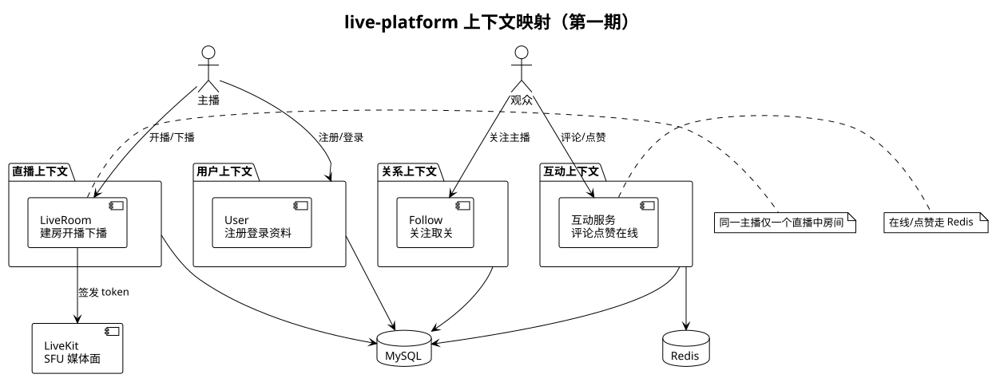
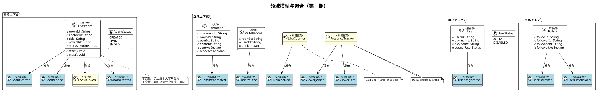
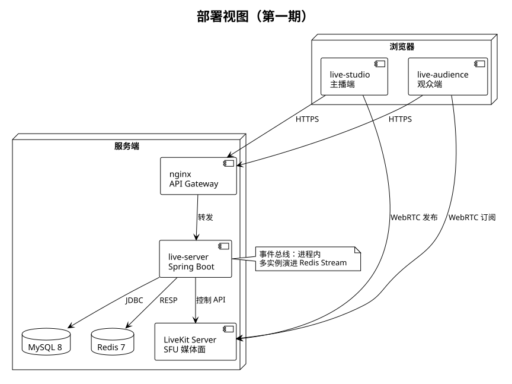

# live-platform 结构文档

> 版本：v1（第一期） · 2026-11-09 · 与 LiveShop 无任何依赖关系

## 1. 产品线定位

独立直播平台，第一期 = 轻量版抖音直播：主播建房开播、观众浏览进房观看、评论/点赞/关注、主播看在线人数并管理评论。媒体面由 LiveKit（WebRTC/SFU）承担，业务面全部在 live-server。

## 2. 限界上下文划分

| 限界上下文 | 职责 | 核心聚合/服务 | 发布的事件 | 依赖 |
| --- | --- | --- | --- | --- |
| 用户上下文 | 注册、登录、资料 | User | UserRegistered | MySQL |
| 关系上下文 | 关注、取关 | Follow | UserFollowed / UserUnfollowed | MySQL、Redis(读模型) |
| 直播上下文 | 建房、开播、下播、进房凭证 | LiveRoom、LivekitToken | RoomCreated / RoomStarted / RoomEnded | MySQL、LiveKit |
| 互动上下文 | 评论、点赞、在线、禁言 | Comment、MuteRecord、LikeCounter、PresenceTracker | CommentPosted / LikeReceived / UserMuted / ViewerJoined / ViewerLeft | MySQL、Redis |

划分原则：每个上下文独立演进、独立事务；跨上下文只通过领域事件与显式 API 协作，不共享表。



## 3. 聚合结构一览



聚合与事务边界规则：

- 一聚合一事务：修改只在聚合根入口（领域方法）发生，application 层不绕过聚合直接改表。
- 跨聚合的协作（如 RoomEnded 后清理媒体房间、更新直播列表缓存）一律走领域事件，不做分布式事务。
- Comment、MuteRecord 归属互动上下文内的房间会话维度，不做全局聚合，按房间分片读写。

## 4. 工程结构（monorepo）

```
live-platform/
├── live-studio/             # 主播端 React（开播控制、评论管理、在线人数）
├── live-audience/           # 观众端 React（发现直播、观看、互动）
├── live-server/             # 后端 Java/Spring Boot（按限界上下文分包）
├── live-protocol/           # API/WS 协议，版本化 v1，先改协议再改代码
├── live-deployment/         # MySQL/Redis/LiveKit compose + 部署说明
└── docs/                    # 本套文档 + uml/（PlantUML 源与图）
```

前后端不共享代码；协议以 live-protocol 为唯一事实源。

## 5. 部署拓扑



- 第一期单机部署：nginx 做 API Gateway（入口转发），live-server 单实例，事件总线为进程内。
- 前端直连 LiveKit Server 推拉流（WebRTC），live-server 只调 LiveKit 控制 API 签发 token。
- 本地开发环境见 `live-deployment/docker-compose.yml`（MySQL 13306 / Redis 16379 / LiveKit 7880）。

## 6. 技术选型

| 层 | 选型 | 说明 |
| --- | --- | --- |
| 后端 | Java 17 + Spring Boot 3.3 | 原 Go 设计 2026-11-09 拍板改 Java |
| 实时互动 | Spring WebSocket | 自建 WS 网关，不经 LiveKit data channel |
| 媒体面 | LiveKit Server + livekit-server SDK | 只碰音视频，不承载业务 |
| 存储 | MySQL 8（业务）+ Redis 7（在线/计数/读模型） | 事件溯源不做，领域事件落事件表即可 |
| 前端 | React 18 + Vite + TypeScript | live-studio / live-audience |

## 7. 演进预留

多实例 → 事件总线换 Redis Stream；读模型膨胀 → 独立查询服务；协议升级 → live-protocol v2 并存期双写。第一期代码不得提前实现以上任何一项。
