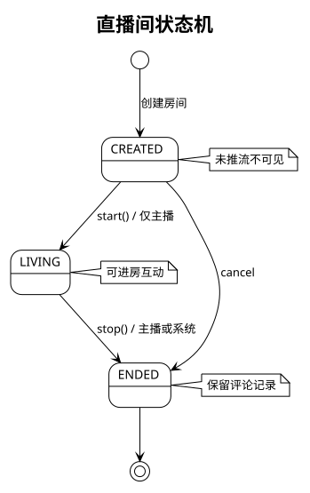
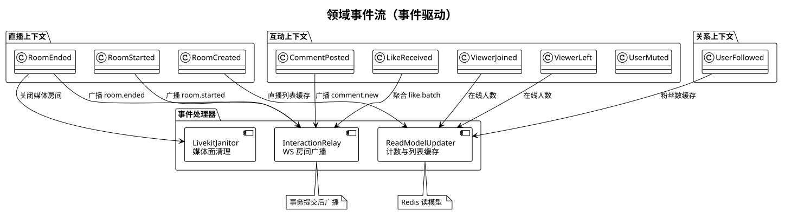
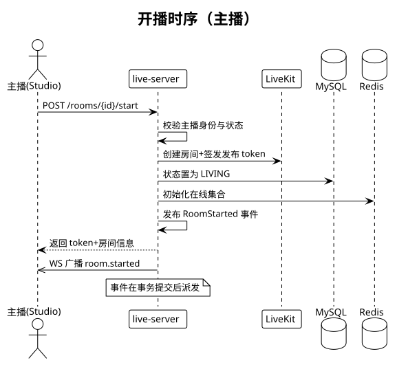
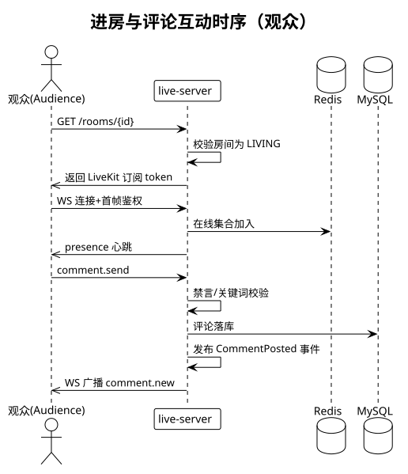

# live-platform 设计文档（DDD · 事件驱动）

> 版本：v1（第一期） · 2026-11-09 · 配套《结构文档》《实现文档》

## 1. 战术设计总览

每个限界上下文内部分四层，包命名固定：

```
<context>/
├── api/            # Controller、WS endpoint、DTO（入站适配器）
├── application/    # Application Service：编排用例、开事务、发事件
├── domain/         # 聚合、实体、值对象、领域服务、领域事件、Repository 接口
└── infrastructure/ # Repository 实现、Redis/LiveKit 适配、事件总线实现
```

硬性规则：

- domain 层不依赖 Spring 注解之外的技术细节；不 import infrastructure。
- 聚合只通过领域方法变更状态；application 层只做编排与事务边界。
- 领域事件由聚合/领域服务在状态变更时记录，事务提交后统一派发（AFTER_COMMIT）。
- 跨上下文禁止直接调对方 Repository；只允许订阅对方发布的事件或调对方 api。

## 2. 用户上下文

**聚合：User**（userId 为根）

- 属性：userId、username、passwordHash、nickname、avatarUrl、status（ACTIVE/DISABLED）。
- 行为：register()（校验用户名唯一）、rename()、disable()。
- 不变量：username 全局唯一，不区分大小写；禁用用户不能登录。
- 事件：UserRegistered。
- 说明：密码 BCrypt；登录颁发 JWT（HS256，2 小时），WS 首帧鉴权复用同一 JWT。

## 3. 关系上下文

**聚合：Follow**（followId 为根，业务唯一键 followerId+followeeId）

- 行为：follow()（幂等，重复关注不产生新事件）、unfollow()。
- 不变量：不能关注自己；目标用户必须存在且 ACTIVE（由 application 层校验后传入）。
- 事件：UserFollowed / UserUnfollowed。
- 读模型：粉丝数/关注数走 Redis（事件订阅者维护），不进聚合状态，避免跨聚合引用。

## 4. 直播上下文

**聚合：LiveRoom**（roomId 为根）

- 属性：roomId、anchorId、title、coverUrl、status、startedAt、endedAt、version（乐观锁）。
- 行为：create()、start()、stop()、cancel()。
- 状态机：



- 不变量：
  - start()/stop() 仅 anchorId 本人可调（application 层校验身份 + 聚合内二次断言）。
  - 同一 anchorId 同时最多一个 LIVING 房间（start 前查存在性，DB 唯一约束兜底：`uk_anchor_living` 过滤索引）。
  - 状态迁移只允许 CREATED→LIVING→ENDED、CREATED→ENDED，其他迁移抛领域异常。
- 值对象 **LivekitToken**：roomName、identity、token、expiresAt；由 media 域的 TokenIssuer 生成（LiveKit Server SDK，发布者 canPublish=true，订阅者 canPublish=false，2 小时有效）。
- 事件：RoomCreated / RoomStarted / RoomEnded。

**进房（观众）**：不走聚合修改，application 校验房间 LIVING 后签发订阅 token 并发布 ViewerJoined。

## 5. 互动上下文

**Comment（实体，按房间会话分片）**

- 属性：commentId、roomId、sessionSeq、userId、nickname 快照、content、sentAt、pinned、blocked。
- 行为：post()（长度≤500）、block()、pin()。
- 校验链：房间 LIVING → 用户未被禁言（MuteRecord）→ 关键词过滤（BlockedWords 配置）→ 落库 → 发布 CommentPosted。
- 事件：CommentPosted（广播 comment.new）、UserMuted（定向 comment.muted）。

**MuteRecord（实体）**：roomId+userId 维度，until 绝对时间；禁言判定在 post 路径同步查 Redis 缓存。

**LikeCounter（领域服务）**：无聚合实体，Redis `INCR` 原子累加房间总赞数；1 秒窗口聚合 delta 后发布 LikeReceived（广播 like.batch）。设计理由：点赞是高频写、弱一致场景，落聚合只会制造热点行。

**PresenceTracker（领域服务）**：WS 连接建立/断开维护 Redis 房间在线集合（`SADD/SREM`+过期兜底），5 秒心跳聚合发布 ViewerJoined/ViewerLeft（广播 presence.heartbeat）。

## 6. 领域事件目录

| 事件 | 发布者 | 关键负载 | 订阅者（第一期） |
| --- | --- | --- | --- |
| UserRegistered | User | userId, nickname | ReadModelUpdater |
| UserFollowed / UserUnfollowed | Follow | followerId, followeeId | ReadModelUpdater |
| RoomCreated | LiveRoom | roomId, anchorId, title | ReadModelUpdater |
| RoomStarted | LiveRoom | roomId, startedAt | InteractionRelay（广播） |
| RoomEnded | LiveRoom | roomId, endedAt | InteractionRelay、LivekitJanitor |
| CommentPosted | Comment | commentId, roomId, userId, content | InteractionRelay |
| LikeReceived | LikeCounter | roomId, total, delta | InteractionRelay |
| UserMuted | MuteRecord | roomId, userId, until | InteractionRelay（定向） |
| ViewerJoined / ViewerLeft | PresenceTracker | roomId, onlineCount | InteractionRelay、ReadModelUpdater |

事件载体统一 envelope：`{eventId, type, occurredAt, payload}`；occurredAt 用 UTC；事件不携带可变大对象（如长文本正文限制 500 字内，传输够用）。

## 7. 事件驱动设计



- **事件总线（第一期）**：Spring `ApplicationEventPublisher` + `@TransactionalEventListener(phase = AFTER_COMMIT)`。进程内、零基础设施；事件处理器异常不影响主流程（异步线程池，失败重试一次后记日志）。
- **事务性保证**：事件在聚合变更的同一事务内记录（内存事件列表随聚合保存），提交后派发；回滚则事件丢弃。无 2PC，无 outbox 表（单实例期进程内即可靠）。
- **幂等**：所有事件带 eventId；订阅者处理前查 Redis `SETNX event:handled:<id>`（24h 过期），防重复广播（如 WS 重连补发场景）。
- **时序**：聚合方法内只记录事件 → application 提交事务 → AFTER_COMMIT 派发 → relay 推 WS。

## 8. 关键时序

开播：



进房与评论：



## 9. 非功能性约束

- 一致性：房间状态/评论落库强一致（同库事务）；在线人数/点赞数最终一致（Redis）。
- 性能基线（第一期）：单房间 1 万在线弹幕聚合广播延迟 P99 < 1s；进房签发 token P99 < 300ms。
- 安全：JWT 签名密钥环境变量注入；LiveKit api-secret 不出现在前端；WS 首帧 5 秒鉴权超时断开。
